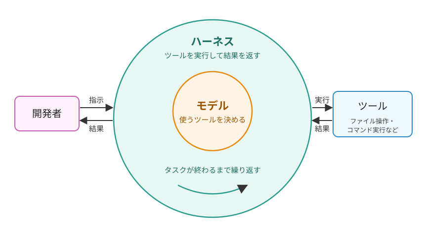

# 1. ハーネスとは

- モデルが選んだツールを実行し、結果をモデルに返す処理をタスク完了まで繰り返す実行基盤
- VS Code の Copilot チャットや Copilot CLI がこれにあたる
- skill や MCP でハーネスの機能を拡張できる

出典：[Understand AI agents（VS Code Docs）](https://code.visualstudio.com/docs/copilot/concepts/overview) ／ [Understand agent harnesses（VS Code Docs）](https://code.visualstudio.com/docs/agents/concepts/agent-harnesses)
