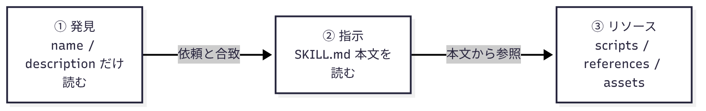

# 2. agent skillとは

## 2.1 定義

- 指示・スクリプト・リソースをまとめたフォルダで、Copilot が必要なときに読み込むもの

出典：[About agent skills（GitHub Docs）](https://docs.github.com/en/copilot/concepts/agents/about-agent-skills)

## 2.2 何のために使うか

| | skill なし | skill あり |
|---|---|---|
| 手順の伝え方 | 毎回プロンプトで説明する | SKILL.md に定義した手順を Copilot が必要時に読み込む |

出典：[About agent skills（GitHub Docs）](https://docs.github.com/en/copilot/concepts/agents/about-agent-skills) ／ [Extending Claude's capabilities with skills and MCP servers（Anthropic）](https://claude.com/blog/extending-claude-capabilities-with-skills-mcp-servers)

## 2.3 置き場所

| 適用範囲 | 置き場所（VS Code・Copilot CLI 共通） |
|---|---|
| PC 全体 | `~/.copilot/skills/<skill名>/` |
| リポジトリ単位 | `.github/skills/<skill名>/` |

出典：[Use Agent Skills in VS Code](https://code.visualstudio.com/docs/agent-customization/agent-skills) ／ [Adding agent skills for Copilot CLI（GitHub Docs）](https://docs.github.com/en/copilot/how-tos/copilot-cli/customize-copilot/add-skills)

## 2.4 フォルダ構成

```text
github-actions-failure-debugging/
├── SKILL.md       # 必須：フロントマター＋手順本文
├── scripts/       # 任意：実行するコード
├── references/    # 任意：必要時に読むドキュメント
└── assets/        # 任意：テンプレートなどのリソース
```

出典：[Agent Skills Specification](https://agentskills.io/specification)

## 2.5 SKILL.md の先頭に書く情報（フロントマター）

```text
---
name: github-actions-failure-debugging   # skill 名（フォルダ名と一致させる）
description: Guide for debugging failing GitHub Actions workflows.   # 何をするか・いつ使うか
---
（ここから本文：手順・例など）
```

出典：[Use Agent Skills in VS Code](https://code.visualstudio.com/docs/agent-customization/agent-skills)

## 2.6 呼び出し方

- **スラッシュコマンド**：チャットで `/skill名` を入力して呼ぶ
- **自動**：依頼内容が `description` と合致したとき、Copilot が読み込む

出典：[Adding agent skills for Copilot CLI（GitHub Docs）](https://docs.github.com/en/copilot/how-tos/copilot-cli/customize-copilot/add-skills)

## 2.7 custom instructions との違い



| | custom instructions | agent skill |
|---|---|---|
| 読み込み | 常に本文全体 | 普段は name・description のみ、使うときに本文 |
| 向いている内容 | ほぼ全タスクに関わる規約 | 特定タスクの詳細な手順 |

- 本文は使うときにしか読み込まれないため、skill を多数入れてもコンテキストウィンドウを圧迫しにくい

出典：[Use Agent Skills in VS Code](https://code.visualstudio.com/docs/agent-customization/agent-skills) ／ [Adding agent skills for Copilot CLI（GitHub Docs）](https://docs.github.com/en/copilot/how-tos/copilot-cli/customize-copilot/add-skills)
