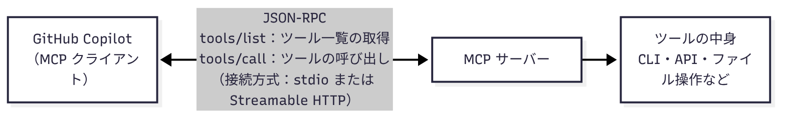

# 3. MCPとは

## 3.1 定義

- Copilot を外部システムに接続するためのオープン標準プロトコル（Model Context Protocol）
- **MCP サーバー**：CLI や API などをラップした「ツール」を提供する側
- **MCP クライアント**：サーバーからツール一覧を取得し、ツールを呼び出す側（GitHub Copilot）

出典：[MCP Architecture overview](https://modelcontextprotocol.io/docs/learn/architecture) ／ [Overview of MCP（GitHub Docs）](https://docs.github.com/en/copilot/concepts/customizations/mcp)

## 3.2 何のために使うか

| | MCP なし | MCP あり |
|---|---|---|
| 外部システムの情報 | 開発者が調べてプロンプトに貼る | Copilot が自分で取得する |
| 外部システムの操作 | 開発者が手作業で行う | Copilot がツールを呼び出して実行する |

出典：[Overview of MCP（GitHub Docs）](https://docs.github.com/en/copilot/concepts/customizations/mcp) ／ [Extending Claude's capabilities with skills and MCP servers（Anthropic）](https://claude.com/blog/extending-claude-capabilities-with-skills-mcp-servers)

## 3.3 サーバーとの接続方式（トランスポート）

| 方式 | サーバーの動かし方 |
|---|---|
| stdio | Copilot がサーバーを子プロセスとして起動し、標準入出力で通信する |
| Streamable HTTP | 起動済みのサーバーに URL を指定して HTTP で接続する |

出典：[MCP Specification: Transports](https://modelcontextprotocol.io/specification/latest/basic/transports) ／ [Adding MCP servers for Copilot CLI（GitHub Docs）](https://docs.github.com/en/copilot/how-tos/copilot-cli/customize-copilot/add-mcp-servers)

## 3.4 設定ファイルの置き場所

| 適用範囲 | 置き場所（VS Code・Copilot CLI 共通） |
|---|---|
| PC 全体 | `~/.copilot/mcp-config.json` |
| リポジトリ単位 | `.mcp.json`（リポジトリ直下） |

出典：[MCP configuration reference（VS Code）](https://code.visualstudio.com/docs/agents/reference/mcp-configuration) ／ [Adding MCP servers for Copilot CLI（GitHub Docs）](https://docs.github.com/en/copilot/how-tos/copilot-cli/customize-copilot/add-mcp-servers)

## 3.5 skill との使い分け

- 手順・ノウハウを与える → skill
- 外部システムへのアクセス手段を与える → MCP
- 組み合わせて使うことも多い（skill の手順の中で MCP のツールを呼び出す）

出典：[Extending Claude's capabilities with skills and MCP servers（Anthropic）](https://claude.com/blog/extending-claude-capabilities-with-skills-mcp-servers) ／ [Overview of MCP（GitHub Docs）](https://docs.github.com/en/copilot/concepts/customizations/mcp)
