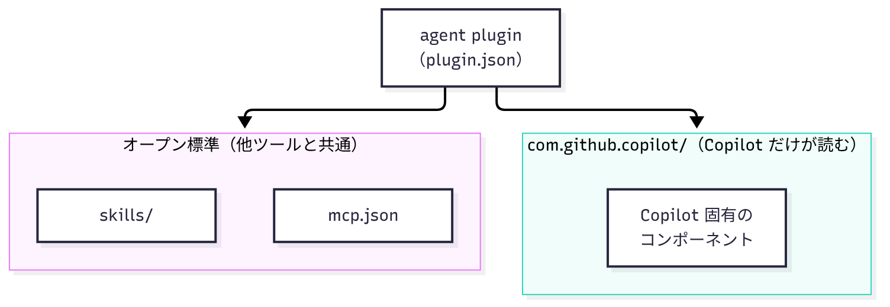

# 4. agent pluginとは

## 4.1 定義

- skill や MCP 設定などを 1 つにまとめた配布用パッケージ

出典：[About plugins（GitHub Docs）](https://docs.github.com/en/copilot/concepts/agents/about-plugins)

## 4.2 何のために使うか

| | plugin なし | plugin あり |
|---|---|---|
| 導入 | skill・MCP 設定を個別に配置する | 1 回のインストールで一式を導入できる |

出典：[About plugins（GitHub Docs）](https://docs.github.com/en/copilot/concepts/agents/about-plugins)

## 4.3 実例デモ

- インストールから実行まで

## 4.4 Agent Plugins 1.0

- 目的：plugin を 1 つ作れば、Copilot 以外の対応する AI ツールでも使えるようにする
- 2026 年 8 月公開のオープン標準
- 標準化されているのは `skills/` と `mcp.json`。Copilot 固有のコンポーネントは `com.github.copilot/` に配置する

出典：[Agent Plugins 1.0 in VS Code, Copilot CLI, and the Copilot app（GitHub Changelog）](https://github.blog/changelog/2026-08-12-agent-plugins-1-0-in-vs-code-copilot-cli-and-the-copilot-app) ／ [About plugins（GitHub Docs）](https://docs.github.com/en/copilot/concepts/agents/about-plugins)
