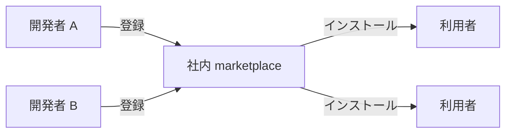

# 6. 社内提案

## 6.1 現状の課題

- skill・MCP 設定が個人の PC や各リポジトリに散在している
- 共有の仕組みがなく、有用なものがあっても他のメンバーが見つけられない

## 6.2 提案

- 社内専用の marketplace を用意し、skill・MCP を plugin として集約する

| 課題 | 社内 marketplace での解決 |
|---|---|
| 散在している | 1 つのリポジトリで一元管理できる |
| 共有の仕組みがない | marketplace を登録すれば、全員が検索・インストールできる |

