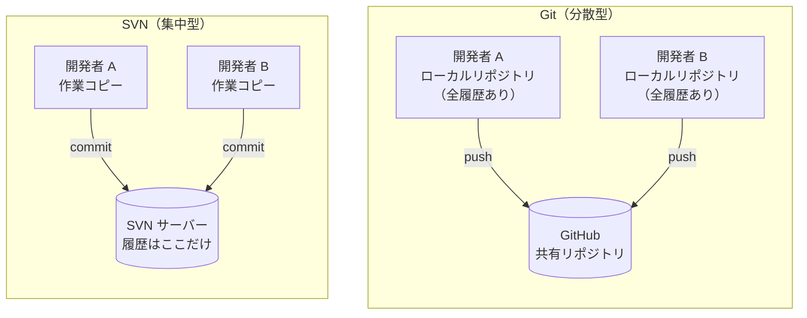
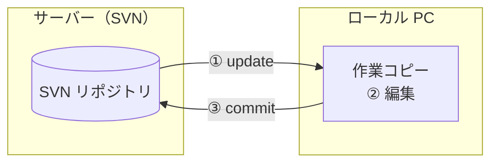
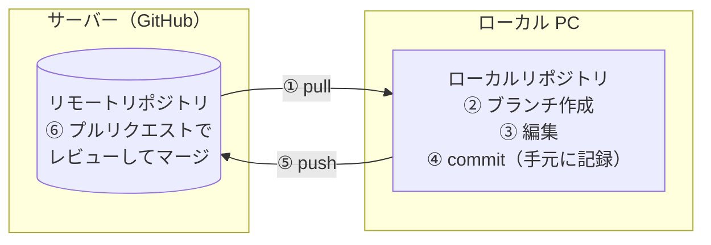

# 1. Git と GitHub の概要

## 1.1 Git とは

- ファイルの変更履歴を管理するツール（SVN と同じ種類のツール）

出典：[Pro Git（日本語版）](https://git-scm.com/book/ja/v2)

## 1.2 GitHub とは

- Git のリポジトリを置いて共有するサービス
- プルリクエスト、Issue、GitHub Actions、GitHub Copilot など、開発を支える機能がある

出典：[GitHub とは（GitHub Docs）](https://docs.github.com/ja/get-started/start-your-journey/what-is-github)

## 1.3 SVN との仕組みの違い

SVN は履歴をサーバーだけが持ちます。Git は各開発者が全履歴を手元に持ち、GitHub で共有します。

## 1.4 SVN との作業の流れの違い

SVN の commit はすぐにサーバーへ反映されます。Git の commit は手元に記録するだけで、push して初めて GitHub に反映されます。GitHub では、作業用のブランチで変更し、プルリクエストでレビューを受けてからマージします。

