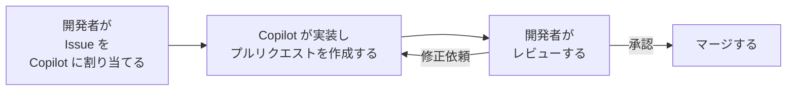

# 2. Git・GitHub のメリット

| メリット | 概要 |
| --- | --- |
| ブランチの作成とマージが容易になる | 作業ごとにブランチを分け、作業途中の変更が他の人に影響しない |
| プルリクエストでレビューが記録に残る | 変更内容、レビューのコメント、承認の記録がまとめて残る |
| Issue と変更を紐づけて管理できる | なぜその変更をしたかを後から追える |
| ビルドやテストを自動化できる | push やプルリクエストのたびに、ビルドとテストが自動で実行される |
| 業界標準である | 開発者の 93% が Git を使用しており、情報や経験者が多い |
| AI 活用の幅が広がる | 複数の作業の並行実行、Issue からの実装、プルリクエストのレビューと修正を AI に任せられる |

## 2.1 ブランチの作成とマージが容易になる

- ブランチは手元ですぐに作れ、作業ごとに分けやすい
- 作業途中の変更も手元のブランチに commit でき、他の人の作業に影響しない

## 2.2 プルリクエストでレビューが記録に残る

- 変更内容、レビューのコメント、承認の記録がプルリクエストにまとめて残る
- 承認されるまでマージできないように設定できる

出典：[Pull Request（GitHub Docs）](https://docs.github.com/ja/pull-requests/reference/pull-requests)

## 2.3 Issue と変更を紐づけて管理できる

- Issue（課題）と、それを解決したプルリクエストを紐づけられる
- 「なぜこの変更をしたか」を後から追える

出典：[プルリクエストを課題にリンクする（GitHub Docs）](https://docs.github.com/ja/issues/tracking-your-work-with-issues/using-issues/linking-a-pull-request-to-an-issue)

## 2.4 ビルドやテストを自動化できる

- GitHub Actions で、push やプルリクエストのたびにビルドとテストを自動で実行できる
- 結果はプルリクエストに表示され、失敗した変更はマージできないように設定できる

出典：[GitHub Actions について（GitHub Docs）](https://docs.github.com/ja/actions/get-started/understand-github-actions)

## 2.5 業界標準である

- Stack Overflow の開発者調査（2022年）では、回答者の 93% が Git を使用
- 情報、ツール、経験者が多い

出典：[Beyond Git: The other version control systems developers use（Stack Overflow Blog）](https://stackoverflow.blog/2023/01/09/beyond-git-the-other-version-control-systems-developers-use)

## 2.6 AI 活用の幅が広がる

Copilot は今の環境でもエディタで使っています。GitHub に移行すると、AI に任せられる作業の範囲が広がります。

### 2.6.1 AI を使った開発の現状

- 2026年9月時点で、GitHub 上のプルリクエストの 40% 以上は、AI が作成した下書きをもとにしている（3月は 17%）
- 主要な AI ツールの新しい機能は、Git のブランチで作業し、プルリクエストで人のレビューを受ける流れを前提にしている

| ツール | Git・GitHub を前提とする機能の例 |
| --- | --- |
| GitHub Copilot | Issue からの実装、プルリクエストのレビュー、複数作業の並行実行 |
| Claude Code | クラウドでの作業、複数作業の並行実行 |
| Codex | 複数作業の並行実行、プルリクエストのレビュー |
| Cursor | クラウドでの作業、複数作業の並行実行 |

出典：[Octoverse 2026（GitHub Blog）](https://github.blog/news-insights/octoverse/octoverse-commits-pushes-reach-new-highs-in-2026-as-developers-build-with-agents/) ／ [Claude Code on the web](https://code.claude.com/docs/en/claude-code-on-the-web) ／ [Codex: Git worktrees](https://learn.chatgpt.com/docs/environments/git-worktrees) ／ [Cursor: Cloud Agents](https://cursor.com/docs/cloud-agent)

### 2.6.2 今の環境と移行後で使える機能の比較

| 機能 | 今の環境（SVN） | 移行後（GitHub） |
| --- | --- | --- |
| エディタでのコード補完、チャット | 使える | 使える |
| エディタでのコミットメッセージ生成 | 使えない | 使える |
| 複数の作業を AI に並行して任せる | 作業コピーを手作業で分ければ一部可能 | 使える |
| Issue を割り当てて実装を任せる | 使えない | 使える |
| プルリクエストのレビューと修正 | 使えない | 使える |

出典：[Copilot smart actions（VS Code Docs）](https://code.visualstudio.com/docs/copilot/copilot-smart-actions)

### 2.6.3 複数の作業を AI に並行して任せられる

- AI ツールが作業ごとに Git の worktree（作業フォルダを分ける機能）とブランチを作るため、AI に複数の作業を同時に任せられる
- 手元の作業と AI の作業が混ざらない

出典：[Manage agent sessions（VS Code Docs）](https://code.visualstudio.com/docs/agents/run/sessions/manage-sessions) ／ [Claude Code: Worktrees](https://code.claude.com/docs/en/worktrees)

### 2.6.4 Issue を割り当てて実装を任せられる

- Issue を Copilot に割り当てると、Copilot が実装してプルリクエストを作成する
- マージするかどうかは、開発者がレビューして判断する

出典：[GitHub Copilot エージェントについて（GitHub Docs）](https://docs.github.com/ja/copilot/concepts/agent-capabilities/about-agents/about-github-copilot-agents)

### 2.6.5 プルリクエストのレビューと修正に使える

- プルリクエストのレビュー担当に Copilot を指定すると、変更内容へのコメントが付く
- CI の失敗やコンフリクトを Copilot が修正し、マージできる状態にする

出典：[GitHub Copilot コード レビュー（GitHub Docs）](https://docs.github.com/ja/copilot/concepts/agent-capabilities/agent-powered-workflows-and-operations/code-review) ／ [Agent Merge（GitHub Changelog）](https://github.blog/changelog/2026-10-28-agent-merge-watches-and-fixes-pull-requests-in-the-cloud/)
