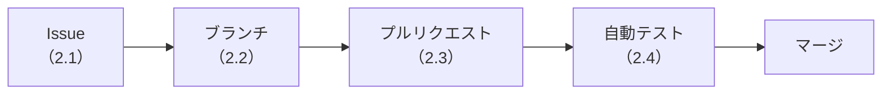

# 2. Git・GitHub のメリット

| メリット | 概要 |
| --- | --- |
| :material-link-variant: Issue と変更を紐づけて管理できる | なぜその変更をしたのかを後から追える |
| :material-source-branch: 作業ごとにブランチを分けやすい | ブランチを手元ですぐに作れ、複数の作業を同時に進められる |
| :material-source-pull: プルリクエストでレビューが記録に残る | 指摘と承認が、変更内容と一緒に残る |
| :material-cog-play: ビルドやテストを自動化できる | テストに通らない変更をマージできないようにできる |
| :material-earth: 業界標準である | 開発者の **93%** が Git を使っている |
| :material-robot-outline: AI 活用の幅が広がる | Issue からの実装やプルリクエストのレビューを AI に任せられる |

2.1〜2.4 は、GitHub での開発の流れの各段階に当たります。

## 2.1 Issue と変更を紐づけて管理できる

- **SVN**：課題管理は、Redmine などの別ツールと連携して行う
- **Git・GitHub**：Issue とプルリクエストが同じ場所にあり、マージすると Issue が自動で閉じる[^1]

## 2.2 作業ごとにブランチを分けやすい

- **SVN**：ブランチはサーバー上のディレクトリとして作る。作成も切り替えもサーバーへの操作になり、作ったブランチは全員から見える[^2]
- **Git・GitHub**：ブランチはコミットを指す目印にすぎず、サーバーを使わずに手元ですぐ作成・切り替え・削除できる。共有したいものだけ push する[^3]
- **Git（worktree）**：1つのリポジトリから作業フォルダを複数作り、別々のブランチを同時に開ける。急な修正の割り込みや、AI に並行して作業させるときに使う[^4]

## 2.3 プルリクエストでレビューが記録に残る

- **SVN**：レビューには別のツールや手段が必要で、記録も変更とは別の場所に残る
- **Git・GitHub**：変更内容、指摘、承認がプルリクエストにまとめて残る[^5]

## 2.4 ビルドやテストを自動化できる

- **SVN**：Jenkins などの CI サーバーを別に用意して連携する
- **Git・GitHub**：GitHub Actions を使え、結果がプルリクエストに表示される[^6]

## 2.5 業界標準である

- Stack Overflow の開発者調査（2022年）では、回答者の **93%** が Git を使っている[^7]
- 情報、ツール、経験者が多い

## 2.6 AI 活用の幅が広がる

Copilot は今もエディタで使っています。移行すると、GitHub 上で AI に作業を任せられるようになります。

| GitHub 上で AI に任せられる作業 | 今の環境 | 移行後 |
| --- | :---: | :---: |
| Issue を割り当てて、実装させる | × | ○ |
| プルリクエストをレビュー・修正させる | × | ○ |
| 複数の作業を並行して進めさせる | △（準備が必要） | ○ |
| リポジトリの指示・skill に沿って作業させる | × | ○ |

- 主要な AI ツール（Copilot、Claude Code、Codex など）の新機能は、ブランチとプルリクエストでの作業を前提にしている[^8]
- エディタで使っている指示や skill は、GitHub 上の AI もそのまま使う[^9]

[^1]: [プルリクエストを課題にリンクする（GitHub Docs）](https://docs.github.com/ja/issues/tracking-your-work-with-issues/using-issues/linking-a-pull-request-to-an-issue)
[^2]: [Using Branches（Version Control with Subversion）](https://svnbook.red-bean.com/en/1.7/svn.branchmerge.using.html)
[^3]: [Git のブランチ機能 - ブランチとは（Pro Git）](https://git-scm.com/book/ja/v2/Git-%E3%81%AE%E3%83%96%E3%83%A9%E3%83%B3%E3%83%81%E6%A9%9F%E8%83%BD-%E3%83%96%E3%83%A9%E3%83%B3%E3%83%81%E3%81%A8%E3%81%AF)
[^4]: [git-worktree（Git Documentation）](https://git-scm.com/docs/git-worktree)
[^5]: [Pull Request（GitHub Docs）](https://docs.github.com/ja/pull-requests/reference/pull-requests)
[^6]: [GitHub Actions について（GitHub Docs）](https://docs.github.com/ja/actions/get-started/understand-github-actions)
[^7]: [Beyond Git: The other version control systems developers use（Stack Overflow Blog）](https://stackoverflow.blog/2023/01/09/beyond-git-the-other-version-control-systems-developers-use)
[^8]: [GitHub Copilot エージェントについて（GitHub Docs）](https://docs.github.com/ja/copilot/concepts/agent-capabilities/about-agents/about-github-copilot-agents) ／ [Claude Code on the web](https://code.claude.com/docs/en/claude-code-on-the-web) ／ [Codex: Git worktrees](https://learn.chatgpt.com/docs/environments/git-worktrees)
[^9]: [Custom instructions support（GitHub Docs）](https://docs.github.com/en/copilot/reference/custom-instructions-support) ／ [About agent skills（GitHub Docs）](https://docs.github.com/en/copilot/concepts/agents/about-agent-skills)
