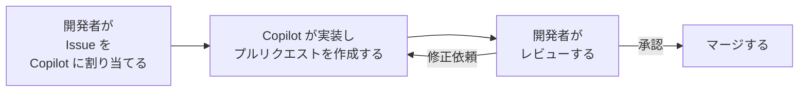

# 3. AI 活用の幅の拡大

Copilot は今の環境でもエディタで使っています。GitHub に移行すると、AI に任せられる作業の範囲が広がります。

## 3.1 AI を使った開発の現状

- 2026年9月時点で、GitHub 上のプルリクエストの 40% 以上が、AI の書いた最初の版から始まっている（3月は 17%）
- 主要な AI ツールは、Git のブランチで作業し、プルリクエストで人のレビューを受ける流れを前提にしている

| ツール | Git・GitHub を前提とする機能の例 |
| --- | --- |
| GitHub Copilot | Issue からの実装、プルリクエストのレビュー、複数作業の並行実行 |
| Claude Code | クラウドでの作業、複数作業の並行実行 |
| Codex | 複数作業の並行実行、プルリクエストのレビュー |
| Cursor | クラウドでの作業、複数作業の並行実行 |

出典：[Octoverse 2026（GitHub Blog）](https://github.blog/news-insights/octoverse/octoverse-commits-pushes-reach-new-highs-in-2026-as-developers-build-with-agents/) ／ [Claude Code on the web](https://code.claude.com/docs/en/claude-code-on-the-web) ／ [Codex: Git worktrees](https://learn.chatgpt.com/docs/environments/git-worktrees) ／ [Cursor: Cloud Agents](https://cursor.com/docs/cloud-agent)

## 3.2 今の環境と移行後で使える機能の比較

| 機能 | 今の環境（SVN） | 移行後（GitHub） |
| --- | --- | --- |
| エディタでのコード補完、チャット | 使える | 使える |
| エディタでのコミットメッセージ生成、変更内容のレビュー | 使えない | 使える |
| 複数の作業を AI に並行して任せる | 使えない | 使える |
| Issue を割り当てて実装を任せる | 使えない | 使える |
| プルリクエストのレビューと修正 | 使えない | 使える |

出典：[Copilot smart actions（VS Code Docs）](https://code.visualstudio.com/docs/copilot/copilot-smart-actions)

## 3.3 複数の作業を AI に並行して任せられる

- 作業ごとに Git の worktree（作業フォルダを分ける機能）とブランチを使い、複数の AI を同時に動かせる
- 手元の作業と AI の作業が混ざらない

出典：[Manage agent sessions（VS Code Docs）](https://code.visualstudio.com/docs/agents/run/sessions/manage-sessions) ／ [Claude Code: Worktrees](https://code.claude.com/docs/en/worktrees)

## 3.4 Issue を割り当てて実装を任せられる

- Issue を Copilot に割り当てると、Copilot が実装してプルリクエストを作成する
- マージするかどうかは、開発者がレビューして判断する

出典：[GitHub Copilot エージェントについて（GitHub Docs）](https://docs.github.com/ja/copilot/concepts/agent-capabilities/about-agents/about-github-copilot-agents)

## 3.5 プルリクエストのレビューと修正に使える

- プルリクエストのレビュー担当に Copilot を指定すると、変更内容へのコメントが付く
- CI の失敗やコンフリクトを Copilot が修正し、マージできる状態にする

出典：[GitHub Copilot コード レビュー（GitHub Docs）](https://docs.github.com/ja/copilot/concepts/agent-capabilities/agent-powered-workflows-and-operations/code-review) ／ [Agent Merge（GitHub Changelog）](https://github.blog/changelog/2026-10-28-agent-merge-watches-and-fixes-pull-requests-in-the-cloud/)
